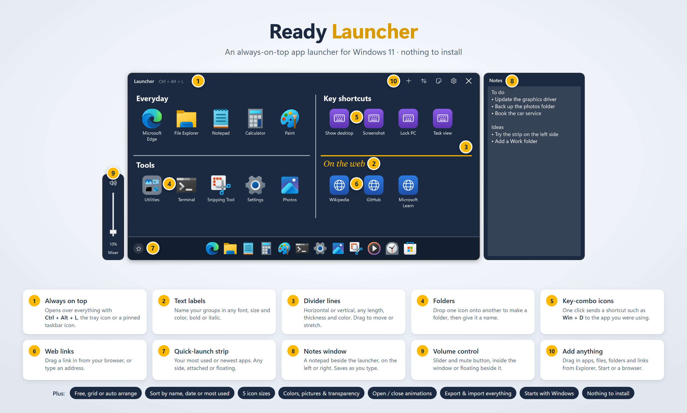
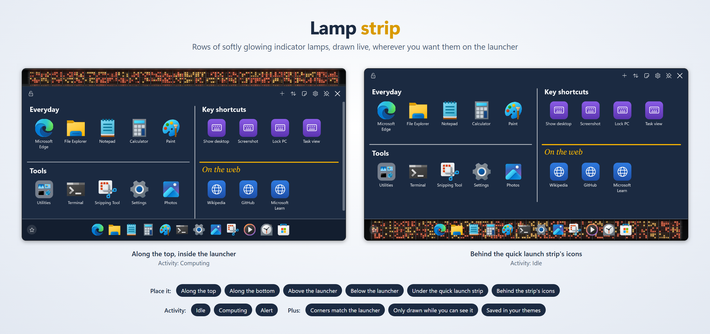
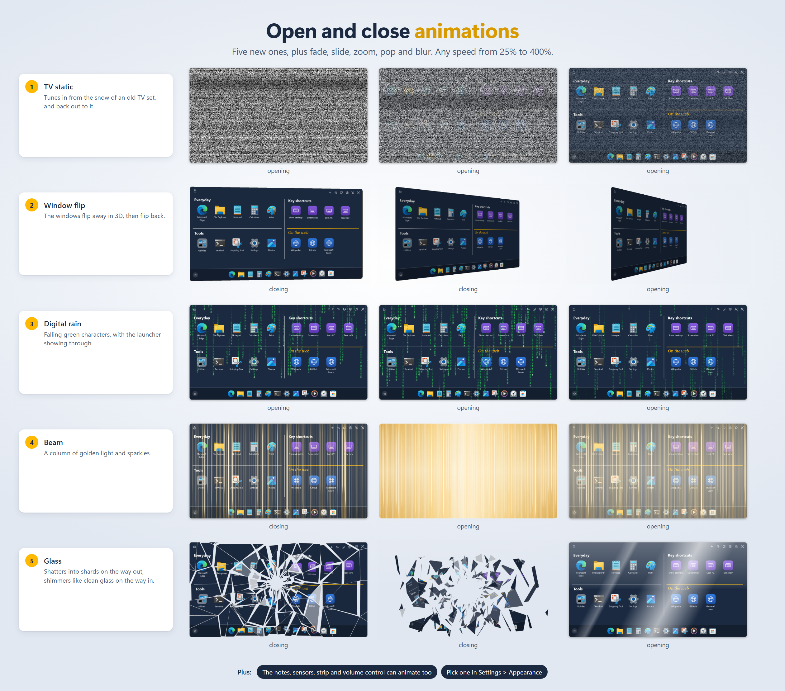

# Ready Launcher

An always-on-top app launcher window for Windows 11. Nothing to install: it is built with the
C# compiler and WPF that ship with Windows (.NET Framework 4.8).

**Download:** get `ReadyLauncher.exe` from the [latest release](https://github.com/seenixh/ReadyLauncher/releases/latest)
and double-click it, or build it yourself as described below.

### Sensor tiles

Live readings above the launcher, each with a mini graph, warning colors, a gear for its settings, and its
highest and lowest readings when you point at it (see *Hardware monitoring* below).

### Lamp strip

Rows of glowing indicator lamps, drawn live, along the top or bottom, outside the launcher, or behind the
quick launch strip's icons.

### Open and close animations

## Build and run

1. Double-click `build.cmd` (or run `build.ps1`). The app is written to `bin\ReadyLauncher.exe`.
2. Run `bin\ReadyLauncher.exe`. Right-click its taskbar button and choose **Pin to taskbar** if you
   want a launcher icon; clicking it brings the launcher window to the front.

## Using it

| To do this | Do this |
|---|---|
| Open / hide the launcher | Press **Ctrl + Alt + L** (change it in Settings), click the tray icon, or click the pinned icon. **Esc** hides it. |
| Hide or show the sensor bar | Click the sensors button (a pulse line) in the header, next to the notes button. It only appears when sensors are chosen in Settings → Hardware monitoring, is dimmed while the bar is hidden, and the launcher remembers the choice. Choosing different sensors in Settings shows the bar again. |
| Keep the launcher open in the background | Click the unpin button in the header (next to ✕), or right-click an empty spot → *Send to background*. The launcher (with its notes, sensors and strip) moves behind your other windows and stays open: it doesn't close itself when you click elsewhere or open an app from it. The shortcut key brings it forward. Click the button again (*Keep on top again*) to put it back on top; once it's closed, it opens always on top again. |
| Add an app, file or folder | Drag it from Explorer, the desktop or the Start menu onto the launcher (it keeps its own icon), or click **+** and browse to it. |
| Add a web link | Drag a link from your browser, or **+** → *Add a web link*. |
| Move an icon | Drag it anywhere. |
| Lock the layout | Click the padlock at the top left: icons, folders, lines, text and the readings on the sensor bar stay where they are (dragging does nothing, and arranging / sorting waits) until you click it again to unlock. Opening, selecting and adding things still works, and a sensor's right-click menu (graph, warning levels) too. |
| Open icons | One click opens an icon, folder, quick-launch app or text link; or tick *Open icons with a double-click* in Settings → General to need a double-click instead. |
| Make a folder | Drag one icon on top of another; type the folder's name. Drag more icons onto the folder to add them. |
| Take an icon out of a folder | Open the folder and drag the icon out, or right-click → *Move out of folder*. |
| Add every installed app | **+** → *Add all installed apps* (or Settings → **Apps**). Group them by category, company, first letter, desktop/Store app or install date, as **folders** or as **labeled groups** right on the launcher (what you already had becomes the first group, "Existing"), and choose the order (name, company, category, newest, oldest, most used). New icons fill empty spots from the top; if they don't all fit and scrolling is off, scrolling is switched on. |
| Select several things | Drag on an empty spot to draw a box around icons, lines and text, or Ctrl+click them one by one (**Ctrl+A** selects everything). Drag any selected item to move them all; press **Delete** to remove them; right-click for *Put the selected icons in a new folder*. **Esc** or a click on an empty spot clears the selection. |
| Arrange icons | The sort button in the header: free placement, free placement aligned to nearby icons, align to grid, auto arrange, sort by name / date added / company / category / most used. |
| Line icons up as you place them | Choose *Free placement, align to nearby icons*. A dragged icon lines up with the nearest icon beside it (same row) and above or below it (same column), and sits exactly one icon's spacing from a neighbor it's dropped next to. Dashed guide lines show what it lines up with while you drag. Drop it away from other icons and it stays exactly where you let go. It works for one icon, several selected icons, and icons dragged in from Explorer. |
| Change an icon's picture | Right-click it → *Change icon* → a Windows icon, any picture, or back to the original. |
| Run as admin, open file location, rename, remove | Right-click an icon. Removing only removes the shortcut from the launcher. |
| Make an icon that presses keys | **+** → *Add a keyboard shortcut*, then press the combination (tick **Win** for Windows-key combos such as Win + D). Clicking the icon sends those keys to the app you were using. |
| Add a divider line | **+** (or right-click an empty spot) → *Add a horizontal line* / *Add a vertical line*. Choose direction, length, thickness and color; the line updates live while you choose. |
| Add text | **+** (or right-click an empty spot) → *Add text*. New text starts at the top center. Choose the font, size, color, bold, italic, underline, a drop shadow (small, medium, large) and an outline (thin, thick), each in any color. |
| Make clickable text | In the text settings, *When clicked* can open a web address, run a Windows command or file, or press a key combination. Or right-click any icon → *Create a text link*. A link opens with one click. |
| Move or change a line or text | Drag it to move it. Drag the far end of a line to change its length. Double-click it (right-click for a link) to change its settings; right-click for duplicate, flip direction or remove. |
| Pick any color | Every color setting has a color wheel button next to it. |
| Color the buttons, volume control, icon names or notes tabs | Settings → Appearance → *Colors of the launcher's parts*: one color each, or the same color for all four. |
| Dress everything up at once | Settings → Appearance → *Theme*: a background picture and matching colors for every window and button. *Christmas Lights* is a snowy night with a house covered in big colored bulbs. *None* puts your own look back. |
| Save your look as a theme, or share one | Settings → Appearance → *Save as theme...* keeps your pictures, colors, see-through settings, animation and lamp strip under a name. *Export...* saves the chosen theme to a `.rltheme` file; *Import...* adds one someone shared. |
| Add blinking computer lamps | Settings → Appearance → *Lamp strip*: inside the launcher (top or bottom), floating above or below it, along the bottom of the quick launch strip, or behind its icons; *Lamp activity* sets idle, computing or alert. |
| Take notes | Click the notes button at the top of the launcher and pick left or right. The notes window opens and closes with the launcher and saves as you type. Its save button writes all the notes (every tab) to a text file. |
| Notes tabs | Click **+** for a new tab (type its name, Enter). Double-click a tab to rename it; right-click it to move it left or right, give it its own **color** (shown as a dot on the tab), or delete it. Right after deleting, **Undo** under the tabs brings it back with its notes (for about 12 seconds). |
| Find in notes | **Ctrl+F** opens a find box above the text: it searches every tab as you type, jumping to other tabs as needed. Enter / F3 for the next match, Shift+Enter / Shift+F3 for the previous one, Esc to close. |
| Headings, date and time | Right-click → *Style*: Title (Ctrl+1), Heading (Ctrl+2), Subheading (Ctrl+3), Normal text (Ctrl+0). **F5** types the time and date, like Windows Notepad. |
| Resize the notes | Drag the notes window's outer edge (the side away from the launcher). The width is kept, and shows in Settings → Notes. |
| Format notes | Right-click the text: **bold**, *italic*, underline, strikethrough, text size, text color, highlight, bullets, numbering and checkboxes, plus the notes background color. Select text first to format just that. Keys: Ctrl+B / I / U, Ctrl+Shift+X (strikethrough), Ctrl+Shift+L (bullets), Ctrl+Shift+N (numbering), Ctrl+Shift+C (checkbox), Ctrl+] / Ctrl+[ (bigger / smaller). |
| Checklists | Ticking a checkbox strikes its line through (unticking takes it off). Enter on a checkbox line starts a new one; Enter on an empty checkbox line ends the checklist. |
| Indented lists | **Tab** on a bulleted or numbered line indents it under the line above (Shift+Tab moves it back). Indents are kept when the launcher restarts, and so is centered / right-aligned text (Ctrl+E / Ctrl+R; Ctrl+L for left). |
| Links in notes | Web addresses you type or paste (https://..., www...., or names like youtube.com) become links: as soon as you move on from one you're typing, straight away when pasted. **Click** a link to open it in your browser (the pointer turns into a hand over links); dragging across one selects its text instead, for editing. Right-click a link for *Open link*, *Copy link* or *Remove link (plain text)*; an address made plain stays plain in that tab (right-click it for *Make it a link* to undo). Email addresses aren't turned into links. |

The quick-launch strip shows your **most frequently used apps** (from Windows' own usage data plus
launches from this launcher) or your **most recently installed apps**. Switch between them with the
round button at the start of the strip.

**Settings** (gear icon or tray menu) stays in front of the launcher while it's open, and closes when
the launcher closes (changes you haven't applied are dropped, as with Cancel). Rest the mouse on any
setting's title, option or button for a short description of what it does (each sensor in the list says
what it measures). It has six tabs:

- **General**: open shortcut, launcher size (small, medium, large or a custom width x height in
  pixels), open/close animation (fade, slide up, slide down, zoom, pop, blur, TV static, flip, digital rain, beam, glass, or none), its speed (25% to 300%) and which windows beside the launcher animate with it (all of them, or any of: notes, sensor bar, detached strip, outside volume control), volume
  control (off, or inside/outside the launcher on either side), its size (small to extra large) and
  how far an outside volume control sits from the window, open icons with a double-click, hide-after-launch, hide-when-clicking-away,
  start with Windows, the **Settings theme** (a square button in each theme's color: follow system,
  light, light grey, grey, dark grey, dark or Christmas; you see each one right away; the text / line, keyboard
  shortcut, add-all-apps and warning levels windows use it too, and checkboxes are a shade darker than their
  panel rather than white; the notes' checklist boxes take the notes' own colors), **Backup**: *Export* / *Import*
  and automatic backups (see below), and **Updates**: the version you
  have, *Check for updates*, and a link to the project on GitHub. When GitHub has a newer release,
  the launcher offers to download it, swaps it in and restarts by itself; your icons, notes and
  settings are kept.
- **Appearance**: icon size (tiny, extra small, small, medium, large), names under icons, icon layout, scrolling on/off
  (the scroll bar takes a shade of the background color), background color, background transparency
  (icons stay solid), background picture and its transparency. **Disable** switches a picture off but keeps it chosen (its location stays in the box, greyed out); **Enable** switches it back on, and choosing a new picture with Browse switches it on too.
  **Theme**: a ready-made look for everything at once: the background picture and the colors of the launcher, its
  buttons, the volume control, icon names, the notes window, the quick launch strip, the sensor bar and the Settings window.
  *Christmas Lights* is a snowy night with a house covered in big old-fashioned colored bulbs, in pine green, cranberry
  red and gold. Your own look is kept while a theme is on: choose *None* to put it back exactly as it was.
  *Save as theme...* keeps the look you've set up (pictures, colors, see-through settings, animation and lamp strip)
  as a theme of your own, with its own copies of the pictures; *Delete* removes one of yours. *Export...* saves the
  chosen theme as a single `.rltheme` file with its pictures inside, to share; *Import...* adds one. A theme file
  holds only colors, settings and pictures: colors are checked, pictures must really be pictures (30 MB at most), and
  anything else is ignored. A theme file can also name a picture that sits next to it instead of carrying it inside.
  **Colors of the launcher's parts**: a color for the top buttons (and the strip's round button), the volume control
  (its text, mute button and slider), the names under icons, and the notes window's title, tabs and buttons. **Auto**
  keeps each one readable on what's behind it. Tick *Use the same color for all four* to give them one shared color
  instead; the four separate colors are kept for when you untick it.
  **Lamp strip**: a strip of blinking red and amber lamps, like the front of an early-1980s mainframe. It can sit
  inside the launcher (along its top edge with the buttons below it, where it also moves the launcher when dragged, or
  along the bottom), sit outside it right against its top or bottom
  edge (a floating quick launch strip or the sensor bar moves out to make room), run along the bottom of the
  quick launch strip, or fill the strip behind its icons. *Lamp activity* sets how busy it looks: idle, computing, or
  alert (busier, with a band of light sweeping along). It only runs while the launcher is showing.
- **Quick launch strip**: what it shows, how many apps (1 to 30), icon size (tiny to extra large, or the same as the launcher), position (bottom, top, left, right),
  detach it into its own floating bar and how far it sits from the window, icon alignment, divider
  line on/off, strip color, strip picture (with the same Disable / Enable) and its transparency, and the strip's overall transparency.
- **Notes**: notes window off / left / right, its distance from the launcher, its width and text size, and the
  notes background color: the area behind the text (the window keeps the launcher color, and its title and tabs
  take the color from Appearance; Auto is a light tint of the launcher color). The text turns dark or light to stay readable on the color. Text pasted from
  other apps comes in plain, in the notes' own style; text copied within the notes keeps its formatting.
- **Apps**: add all installed apps, and add a shortcut automatically whenever an app is installed
  (into a "New apps" folder, or as icons on the launcher). This works for desktop and Microsoft Store
  apps, and catches apps installed while the launcher wasn't running.
- **Hardware monitoring**: pick live readings to show in a bar just above the launcher: lined up left,
  center or right, small / medium / large, checked every N seconds (you type the number; 5 by
  default), with your own text and background colors (or automatic). Rows can fill from the top, or
  from the bottom row next to the launcher with extra rows going above it. Drag a reading on the bar to
  move it to a new place. Show them as compact readings (name and value) or as tiles with a mini graph
  of the last 30, 60, 120 or 240 readings: percentages are drawn from 0 to 100, speeds and ping from 0,
  temperatures, clocks and the like between their recent lowest and highest values, and online / offline
  as a row of green and red marks. Each kind of reading has its own graph color. Sensors that are text
  (IP address, busiest app, PC name...) get a tile with just the value. Point at a tile and its tooltip
  shows the highest and lowest of the readings in its graph and when each was last reached ("Highest
  20 ms at 2:41:05 PM", "Lowest 4 ms at 2:39:50 PM"; "steady at ... since ..." when it didn't change, and
  for online / offline how many times it was online and when it was last offline). The day is added for
  a time that wasn't today.
  A small gear at the top right of each tile with settings opens a menu to show or hide its graph and
  set its warning levels (right-clicking the tile opens it too); pointing at the gear explains how tiles
  work, so the tiles' own tooltips stay short. The tiles' text can sit top left or centered (across, and up and down on tiles
  without a graph). **Warning colors** (on by default): a reading turns amber at its warning level and
  red at its critical level (its value and a thicker border; on a tile, the part of the graph past the
  level too, with faint dashed lines where the levels are). Built-in levels: 85% / 95% for processor,
  graphics and memory load, 90% / 100% for disk active time, 80 / 90 °C for temperatures (176 / 194 °F),
  100 / 250 ms for ping, and "lower is worse" levels for battery charge (20% / 10%), battery time left
  (30 / 10 minutes) and Wi-Fi signal (40% / 20%). Set your own for any sensor that measures a number
  (higher or lower is worse, either level can be left empty) with a tile's gear or by right-clicking it on the bar, or for all
  of them at once with *Warning levels...* in Settings; *Default* goes back to the built-in levels.
  Amber and red are kept for warnings, so no normal reading uses them. The list of sensors has a tab per provider: Windows, HWiNFO, Libre Hardware
  Monitor, and "Sensor Information" (step-by-step setup for both apps, with the PawnIO anti-cheat
  warning and the HWiNFO free-version note). Available without installing anything (what your PC has): CPU load, speed and per-core
  load, busiest app, processes, threads; RAM used, %, committed memory, biggest app; GPU load
  (overall, 3D, video decode/encode, compute, copy) and GPU memory; per network adapter (Ethernet,
  Wi-Fi) download / upload speed, data used, connection speed, Wi-Fi signal and network name; ping
  time, online / offline, local IP address; per disk read / write speed and active time, free space
  per drive; battery or UPS charge and time left; uptime; PC name and user account name.

### More sensors (temperatures, fans, voltages)

Windows doesn't share CPU temperature, fan speeds, voltages or motherboard temperatures with other
apps. Those need a hardware monitoring app: **HWiNFO** or **Libre Hardware Monitor** (both free).
With *Always look for HWiNFO and Libre Hardware Monitor* switched on (the default), their sensors are
added on their own tab (grouped by device), while they're running and sharing them. The tabs update by
themselves when either app starts or stops. Once found,
their sensors stay listed even after the app is closed: they're greyed out with a note saying the app
isn't active, and any you chose stay on the bar, greyed out and reading "not active", until the app runs
again.

- **Libre Hardware Monitor** needs the PawnIO driver, which it offers to install. It shares its
  sensors when *Options > Remote Web Server > Run* is on (or when it runs as administrator).
  **Warning:** if you play online games, some strict anti-cheat systems, such as FACEIT, have
  flagged PawnIO before and blocked users' PCs from playing.
- **HWiNFO** shares its sensors when *Shared Memory Support* is ticked in its Settings (open
  HWiNFO and click *Settings* before *Start*; it's on the *General / User Interface* tab). The free
  version switches this off again after 12 hours; HWiNFO Pro keeps it on.

The *Check for HWiNFO and Libre Hardware Monitor* button says whether each is installed, running and
sharing, and what to switch on if it isn't.

**Removing PawnIO:** the *PawnIO driver* row on the Hardware monitoring tab says whether the driver is
installed. *Remove PawnIO driver* removes it completely: it runs PawnIO's own uninstaller, then
removes anything left behind (the driver package in Windows' driver store, an unused service entry).
Windows asks for permission first. Close Libre Hardware Monitor before removing it. The button is
greyed out when PawnIO isn't installed. The launcher itself never runs as administrator.

Official downloads only:

- HWiNFO: https://www.hwinfo.com/download/
- Libre Hardware Monitor: https://github.com/LibreHardwareMonitor/LibreHardwareMonitor/releases

**Always download apps only from their official sites.** Copies on other download sites can be out of
date, or bundled with adware or malware.

Your icons and settings are saved in `%APPDATA%\ReadyLauncher\launcher.xml`.

### Backup (export and import)

**Export** writes one `.xml` file with everything: icons, folders, lines, text, notes, all settings,
and copies of your background pictures and custom icon pictures. **Import** replaces everything with a file you exported
(here or on another PC). The window stays where it is on this screen. Pictures that don't exist on
this PC are restored into `%APPDATA%\ReadyLauncher\Pictures`. Before importing, your current setup is
saved as `%APPDATA%\ReadyLauncher\launcher.before-import.xml`; import that file to undo.

**Automatic backups** (off unless you switch them on): *Back up automatically every N days* (1 to 365)
saves the same kind of backup file into a folder you choose on a drive of this PC (not a network
drive; `Documents\Ready Launcher backups` to start with). Each backup is a new file named with the date
and time it was made, like `Launcher backup 2026-11-16 14-05-32.xml`; older ones are kept. A backup
that came due while the PC was off is saved shortly after the launcher starts. *Back up now* saves one
right away. If the folder can't be reached (for example a USB drive that isn't plugged in), the tray
icon says so.

## Source layout

- `src/Program.cs`: startup, single instance, tray icon, global hotkey, start-with-Windows
- `src/LauncherWindow*.cs`: the window (layout, drag & drop, folders, menus, quick-launch strip,
  lines and text in `.Decor.cs`, the notes window's placement in `.Notes.cs`, and in `.Snapshot.cs`
  a test-only helper that saves clean window images for documentation)
- `src/DecorationDialog.cs`: the line / text settings dialog; `src/NotesWindow.cs`: the notepad (tabs, the
  right-click formatting menu); `src/NoteDocs.cs`: turning saved notes into formatted text and back
- `src/Backup.cs`: export and import
- `src/AppCatalog.cs`, `src/AddAppsDialog.cs`, `src/LauncherWindow.Apps.cs`: finding installed apps, adding them all, auto-adding new ones
- `src/LauncherWindow.Select.cs`: drag-to-select, moving / removing / grouping several items
- `src/LauncherWindow.Background.cs`: "Send to background" (open behind other windows until closed)
- `src/LauncherWindow.Snap.cs`: free placement that lines icons up with nearby ones, and its guide lines
- `src/Sensors.cs`, `src/SensorWindow.cs`, `src/LauncherWindow.Sensors.cs`, `src/SettingsWindow.Hardware.cs`:
  hardware monitoring (reading sensors, the bar above the launcher with its tiles and mini graphs, the settings tab);
  `src/SensorLevels.cs`, `src/WarningLevelsWindow.cs`: warning colors (built-in levels, your own, and the window to set them);
  `src/ExternalSensors.cs`: reading HWiNFO and Libre Hardware Monitor sensors; `src/PawnIo.cs`:
  finding and removing the PawnIO driver
- `src/TextStyle.cs`: text underline / shadow / outline; `src/ColorPickerDialog.cs`: the color wheel;
  `src/LauncherWindow.Icons.cs`: custom icons
- `src/TileView.cs`: one icon; `src/IconCache.cs`: shell icon loading
- `src/ShellHelper.cs`: launching, drag data, most-used / recently-installed lists
- `src/VolumeControl.cs`: system volume (Core Audio) and the slider panel
- `src/SettingsWindow.cs` (`src/SettingsWindow.Help.cs`: the description for every setting), `src/InputDialog.cs`, `src/Models.cs`, `src/Native.cs`
- `src/SettingsTheme.cs`: the Settings window's seven themes; `src/Themes.cs`: the launcher themes (Theme in Appearance) and the Christmas Lights picture they draw; `src/Updates.cs`: checking GitHub for a
  newer version and installing it
